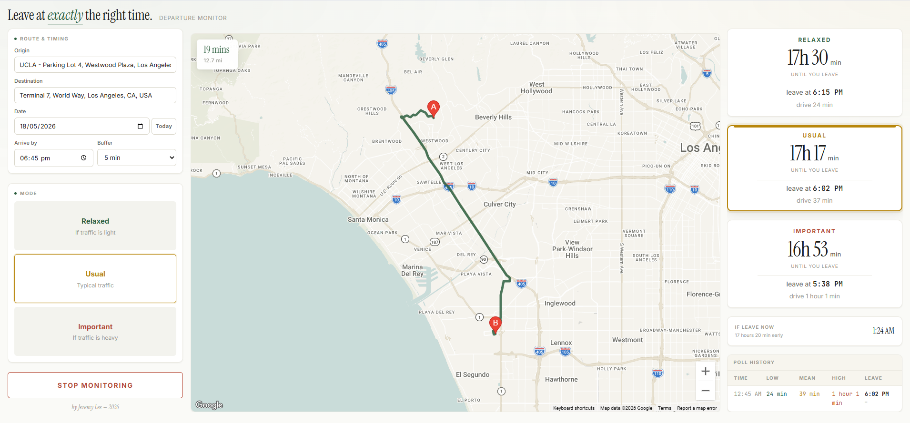

# Leave Time Optimizer

A one-file browser app that works out the latest time you can leave and still arrive on time, using Google's three traffic models to give three risk levels side by side.

[Live app](https://lyhjeremy.github.io/leave-time-optimizer/) (needs your own API key) · [Write-up](https://lyhjeremy.github.io/leave-time-optimizer/overview/) · [Article](https://lyhjeremy.github.io/leave-time-optimizer/leave-time-optimizer-article.html)

Design and copy follow [these standards](https://github.com/lyhjeremy/lyhjeremy/blob/main/DESIGN_STANDARDS.md).

## One trip, three answers

On 18 May 2026 I asked it about UCLA to LAX Terminal 7, arriving 6:45 PM with a 5-minute buffer:

| Mode | Routes API `trafficModel` | Expected drive | Leave at |
|---|---|---|---|
| Relaxed | `OPTIMISTIC` | 24 min | 6:15 PM |
| Usual | `BEST_GUESS` | 37 min | 6:02 PM |
| Important | `PESSIMISTIC` | 61 min | 5:38 PM |

Relaxed and Important are 37 minutes apart, and that gap is why the app shows all three at once: its size tells you how unpredictable the route is.

## How it works

Each departure time goes to the Google Routes API three times, with `trafficModel` set to `OPTIMISTIC`, `BEST_GUESS` and `PESSIMISTIC`. That only works with `routingPreference: TRAFFIC_AWARE_OPTIMAL`; under any other setting the API silently returns the same duration for all three.

The app asks about future departures as well as the present. On Start it sends one anchor request for a departure 20 minutes before the target, and uses that duration to size a departure window (ending at the target minus the buffer, and starting the anchor duration plus 15 minutes before that). Each poll then samples two departure times inside the window plus one for now, which is 9 API calls. With under 25 minutes to go, it samples only now. Polls come every 15 minutes while departure is over an hour away, every 8 at 30 to 60 minutes, and every 3 inside 30.

At the leave-by time you get a browser notification and an on-screen alert, and a poll-history table shows how the recommendation moved along the way.

It is one HTML file of vanilla JavaScript using the Google Routes, Maps JavaScript, Places (classic) and Directions APIs, with no server or build step.

## Setting it up

1. Get a Google Maps API key in the [Google Cloud Console](https://console.cloud.google.com/).
2. Enable four APIs on its project: Routes API, Maps JavaScript API, Places API (the classic one, not "New") and Directions API. Restricting the key to those four is a good idea.
3. Open `leave-time-optimizer-1.17.0.html` in a text editor and paste your key into `const API_KEY = 'fill in your Google API here';` near the top.
4. Save and open the file in a browser.

The article puts Routes API usage at about $0.05 per poll and 5 to 15 polls per trip (May 2026 prices).

## Repo layout

| Path | Contents |
|---|---|
| `leave-time-optimizer-1.17.0.html` | The app |
| `index.html` | Redirect so the Pages root opens the app |
| `leave-time-optimizer-article.md` | Article (served as `.html` by GitHub Pages) |
| `overview/` | Write-up page |
| `images/` | Screenshot, diagrams and hero photo |

## Limitations

You need your own API key, since nothing is hosted. The forecast is Google's, so if the pessimistic model misses an incident, the app misses it too. The layout is built for a desktop browser: below 1080px the columns stack without any phone-specific design, and the countdown depends on the tab staying open. It handles driving only, to one destination per trip.

## License

[MIT](LICENSE) © 2026 Jeremy Lee
