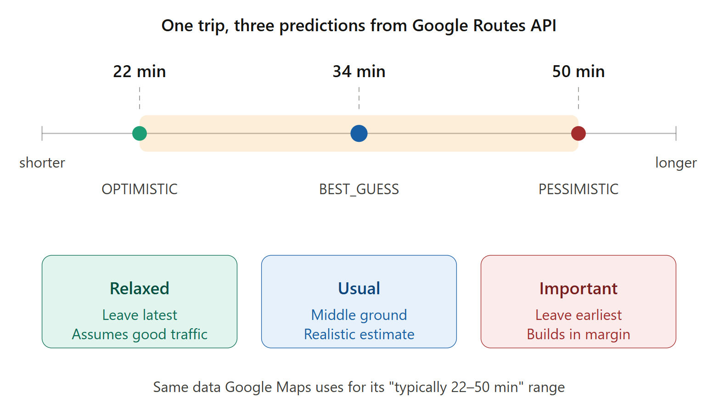
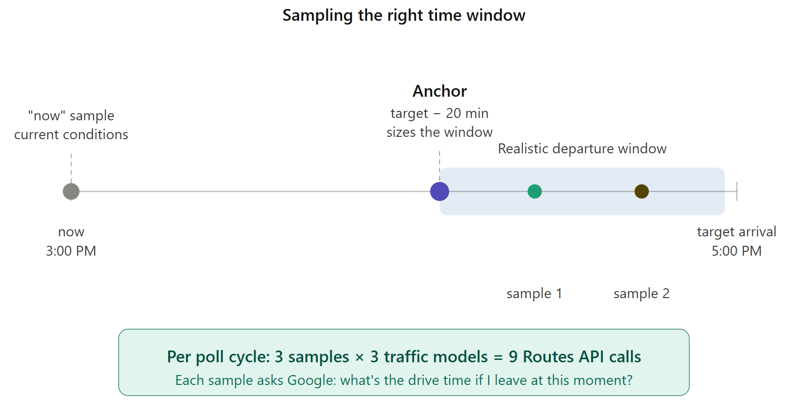

## Leaving on time in LA

If you have lived in Los Angeles, you know the routine.

You have somewhere to be: a 4:30 PM flight out of LAX, a 7 PM dinner downtown, a cousin's wedding in San Gabriel at 2. Google Maps says the drive is 28 minutes, but you have been burned enough times to know 28 can become 65 with no warning, and leaving at 1:15 instead of 1:25 can decide whether you walk in calm or sweating through your shirt.

So you sit at home refreshing Google Maps every few minutes and doing mental subtraction.

> *"It's 28 minutes now. If I add a 15-minute buffer... and traffic usually gets worse around 1:30... should I leave in 5 minutes? 12? Do I have time to put on real shoes?"*

Maps has the information. It even shows a range, *"typically 22 to 50 min"*, that describes how unpredictable the route is. What it doesn't do is tell you *when* to leave. It describes the drive if you left now and leaves the scheduling to you.

I wanted to leave as late as possible without being late. Those two goals pull against each other: don't waste twenty minutes pacing the kitchen, and don't get stuck on the 10 with no margin. Getting it right is the same subtraction repeated every few minutes until you commit and walk out.

So I built a small app to do that subtraction for me.

## What it does

It is a single web page you open in a browser tab while you get ready. You give it three things:

- where you're starting from
- where you're going
- when you need to be there

It works out the latest departure time that still gets you there on time, shows a countdown, and polls Google's Routes API in the background to update the answer as traffic changes. When it's time to leave, it sends a browser notification and shows an on-screen alert.

There are three countdowns side by side, one per risk level:

- **Relaxed** assumes traffic stays light. Latest leave-by time.
- **Usual** assumes typical traffic for the route at that hour.
- **Important** assumes traffic gets bad. Earliest leave-by time.

For a Tuesday lunch with a friend who is always late, I go by Relaxed and stay home as long as I can. For a flight or a job interview, I go by Important and accept that I might arrive twenty minutes early.


*A 6:45 PM arrival at LAX Terminal 7 from UCLA, with a 5-minute buffer. Relaxed expects 24 minutes of driving, Usual 37 and Important 61. The mode decides whether I leave at 6:15 or 5:38.*

That screenshot is the whole case for the tool. A 24-minute drive and a 61-minute drive are the difference between one more episode and leaving right now. Those numbers come from Google's own range; the app turns them into a time on the clock.

## Where the three modes come from

The three risk levels come straight from Google's Routes API. A route request can include a `trafficModel` parameter with one of three values:

- `OPTIMISTIC` assumes traffic will be better than typical.
- `BEST_GUESS` is Google's realistic estimate from live and historical data.
- `PESSIMISTIC` assumes traffic will be worse than typical.

Send the same request with each value and you get three durations. Their spread is the "typically 22 to 50 min" range the Maps app shows. The consumer app shows the range for you to eyeball; the developer API gives you each end as a number you can compute with.

So Relaxed is `OPTIMISTIC`, Usual is `BEST_GUESS` and Important is `PESSIMISTIC`. The app's forecast is exactly as good as Google's; what it adds is turning Google's range into a time to walk out the door.


*The three traffic models and the modes they map to, on an illustrative 22 to 50 minute range.*

One gotcha cost me an embarrassing amount of time: `trafficModel` only takes effect when `routingPreference` is `TRAFFIC_AWARE_OPTIMAL`. With any other routing preference the API ignores the parameter. It doesn't error or warn. It returns the same duration for all three models, which looks like a perfectly plausible answer. If you build anything similar, check that setting first.

## The sampling problem

The obvious version asks Google every few minutes how long the drive is right now and updates the countdown. That works, sort of, but it answers the wrong question: if I plan to leave at 6:00 PM and it's 5:00 PM, the current drive time describes traffic at 5:00. In LA the 405 at 5:00 and the 405 at 6:00 are close to different freeways.

What I want to know is how long the drive will take if I leave during my likely departure window.

So the app samples the future. When I press Start, it sends one anchor request for a departure 20 minutes before my target arrival. From that duration it builds a departure window: the window ends at the target minus my buffer, and starts the anchor duration plus 15 minutes before that.

Each poll then picks two departure times inside the window, plus one "now" sample for live conditions, and sends the three traffic-model requests for each in parallel. One poll is 3 samples times 3 models, or 9 Routes API calls. If the target is less than 25 minutes away, the app skips the window and samples only "now".


*Anchor-and-fan-out sampling: one request sizes the window, then each poll samples inside it.*

The polling interval depends on how far away departure is:

- more than 60 minutes out: every 15 minutes
- 30 to 60 minutes out: every 8 minutes
- under 30 minutes out: every 3 minutes

Far from departure little changes between polls, and close to it the numbers need to be fresh.

## Setup

The app is one HTML file that runs straight from disk, and its only external dependency is Google Maps Platform. Setup takes about five minutes.

**1. Get a Google Maps API key.** In the [Google Cloud Console](https://console.cloud.google.com/), create a project (or use an existing one), then go to `APIs & Services → Credentials → Create Credentials → API key`. The key looks like `AIzaSy...`.

**2. Enable four APIs.** Under `APIs & Services → Library`, enable:

- Routes API, for the traffic-aware forecasts
- Maps JavaScript API, for the map preview
- Places API, for address autocomplete. Use the classic Places API, not "Places API (New)"; the autocomplete widget has not been updated for the new one.
- Directions API, to draw the route line on the map

**3. Restrict the key (recommended).** In Credentials, open the key and under `API restrictions` allow only those four APIs. If the key leaks, nobody can use it for anything else on your bill.

**4. Paste the key into the HTML.** Open `leave-time-optimizer-1.17.0.html` in a text editor and find this line near the top:

```js
const API_KEY = 'fill in your Google API here';
```

Replace the placeholder with your key, save, and open the file in a browser.

**5. Use it.** Enter origin, destination and arrival time, then click "Start Monitoring". The countdown starts, the map draws the route, and the app polls Google in the background. At leave time you get a browser notification (if you allowed notifications) and an on-screen alert.

At the time of writing a poll cycle cost roughly $0.05 in Routes API usage, and a typical session ran 5 to 15 cycles. A trip from my couch to LAX costs between fifty cents and a dollar to plan, which is less than a parking ticket.

## Interface choices

**Three countdowns at once.** I considered a dropdown: pick Usual, see one countdown. In practice the spread between the three is the information I want. In the UCLA to LAX screenshot, Relaxed and Important are 37 minutes apart. A gap that size says the route is volatile and I should go by Important for anything I care about. On a calmer route the three land within five minutes of each other and Relaxed is safe. A dropdown would hide that.

**Poll history.** Every poll adds a row to a table at the bottom right of the dashboard, with the low, mean and high durations and the resulting leave-by time. A green `-2m` means traffic eased and I can leave a little later than the previous poll said; a red `+3m` means it is getting worse. Over a session, the trend tells me whether the current recommendation has settled.

**An operating-system notification.** The tab sits in the background while I pack a bag or look for my keys, so the alert has to come from the operating system; a change inside a tab I can't see is no use.

**Defaults.** Today's date is preselected. The mode resets to Usual on each load. The origin tries to fill itself from GPS, and the last destination is kept in `localStorage`. By the time the tab has loaded, the form is usually one field away from ready.

**Type for glancing.** The countdowns use a large serif numeral, because from the corner of my eye the shape of "18h 4min" reads faster than the digits. The poll-history table is set in a monospace face so the columns line up.

## What's missing

- **Phones.** The layout is built for a desktop browser. Below 1080px the three columns stack into one long page, but nothing in it was designed for a phone, which is the wrong shape for something you check while running around the house.
- **A native app.** The app depends on a browser tab staying alive. Lock a phone for too long and the JavaScript pauses. A native iOS or Android app could use push notifications instead.
- **Calendar integration.** I type the address and arrival time for every trip. Pulling them from Google Calendar would remove that step.
- **Saved routes.** One-tap presets for Home to Office, Home to LAX, Home to my parents' place in San Gabriel would make it useful for routine trips too.
- **Multi-stop trips.** The Routes API supports waypoints; the interface doesn't yet.
- **Transit and biking.** It handles driving only.
- **"Traffic just eased" alerts.** A notice that says "you can leave 8 minutes later than before". The numbers are already computed; it needs a second alert path.
